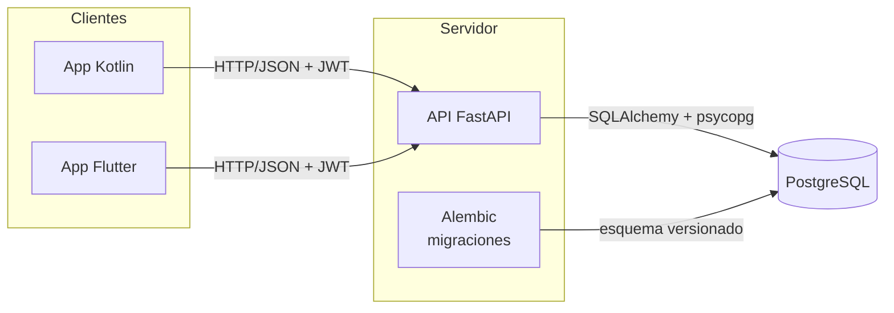
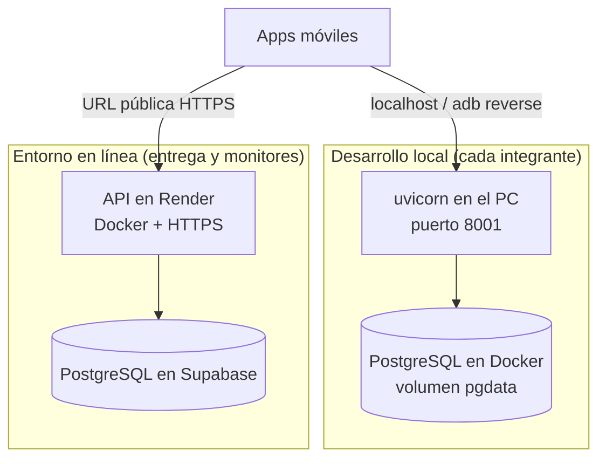
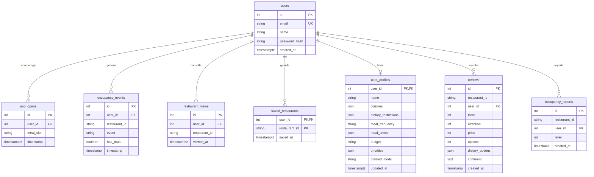
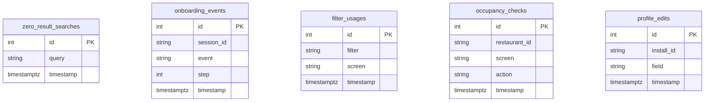
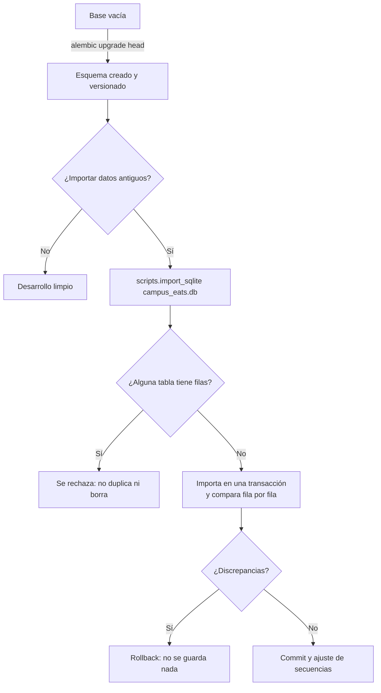

# Arquitectura de la base de datos – Campus Eats

Documento basado en `app/models.py` y en las migraciones de `alembic/versions`. El motor es **PostgreSQL 16**.

## 1. Arquitectura general

Las apps solo hablan con la API por HTTP(S). Ninguna app recibe credenciales de la base de datos.

## 2. Entornos

La única diferencia entre entornos es la variable `DATABASE_URL`; el código y el esquema son los mismos.

## 3. Modelo entidad-relación

`restaurant_id` es texto sin llave foránea porque todavía no existe una tabla `restaurants` en el backend.

### Tablas sin relación con usuarios (analítica anónima)

## 4. Restricciones e índices

| Tabla | Restricción | Detalle |
|---|---|---|
| `users` | Único | `email` (índice único `ix_users_email`) |
| `reviews` | Único compuesto | `uq_review_user_restaurant` sobre `(user_id, restaurant_id)`: una reseña por usuario y restaurante |
| `saved_restaurants` | PK compuesta | `(user_id, restaurant_id)` |
| `user_profiles` | PK = FK | `user_id` → `users.id`, relación 1 a 1 |
| Tablas con `user_id` | Llave foránea | `user_id` → `users.id` |
| Casi todas | Índices | En `id`, `user_id`, `restaurant_id` y columnas de fecha usadas en consultas |

Las contraseñas se guardan como hash bcrypt (`$2b$12$...`); nunca en texto plano. Las 13 tablas tienen *row level security* activada (migración `0002`) sin políticas: solo el rol dueño, que es el que usa la API, puede leerlas.

## 5. Fechas y zonas horarias

| Tipo | Columnas | Comportamiento |
|---|---|---|
| `timestamptz` | `created_at`, `timestamp`, `viewed_at`, `saved_at`, `updated_at` en las tablas anteriores | Valor por defecto `now()` del servidor; se devuelve con zona UTC |
| `timestamp` (sin zona) | `occupancy_events.timestamp`, `reviews.created_at`, `occupancy_reports.created_at` | UTC puesto desde Python, para poder compararlas sin errores |

Cada conexión ejecuta `SET TIME ZONE 'UTC'`.

## 6. Esquema y datos: tres operaciones distintas

## 7. Migraciones

| Revisión | Contenido |
|---|---|
| `0001` | Esquema inicial: 13 tablas, llaves, restricciones e índices |
| `0002` | Activa *row level security* en las 13 tablas |

Comandos: `alembic upgrade head` aplica; `alembic current` muestra la versión; `alembic check` detecta diferencias entre los modelos y la base.
